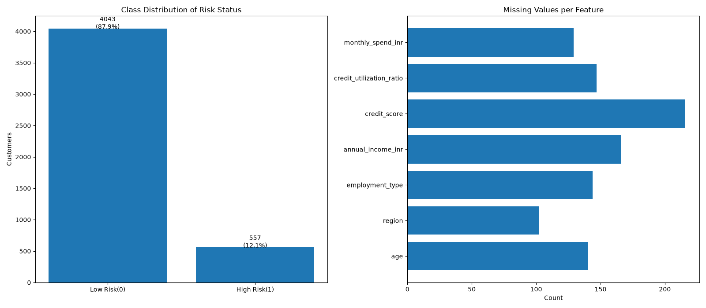
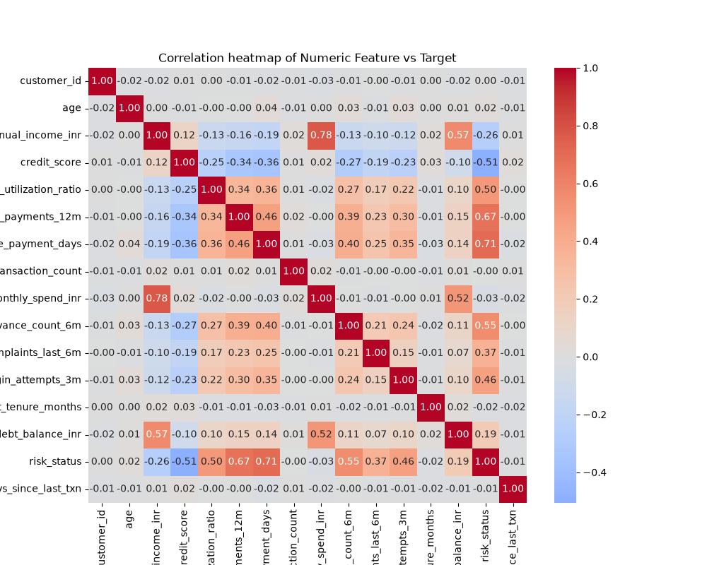
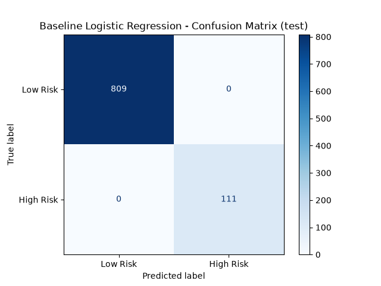
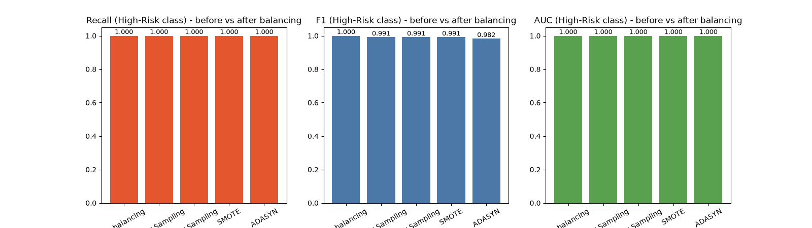
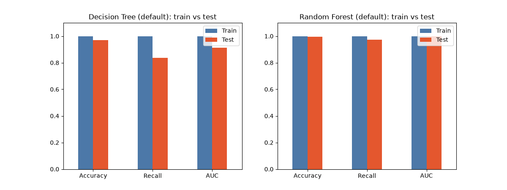
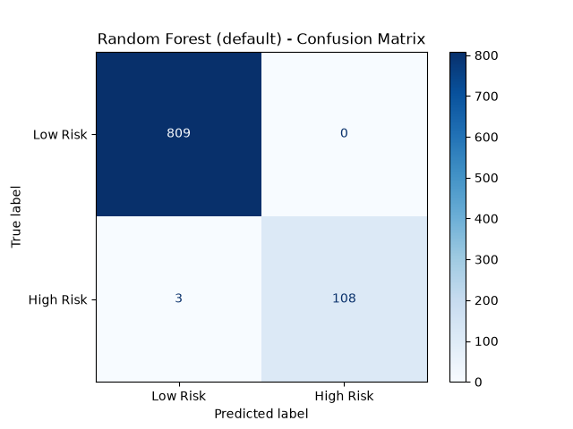
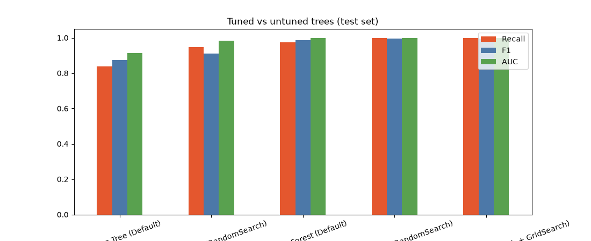
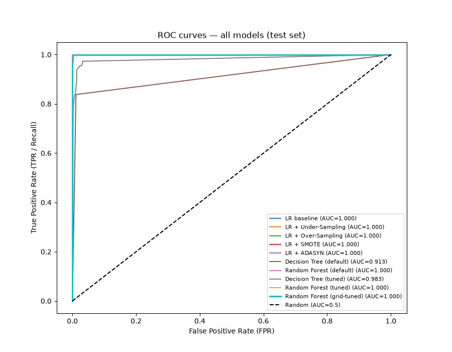
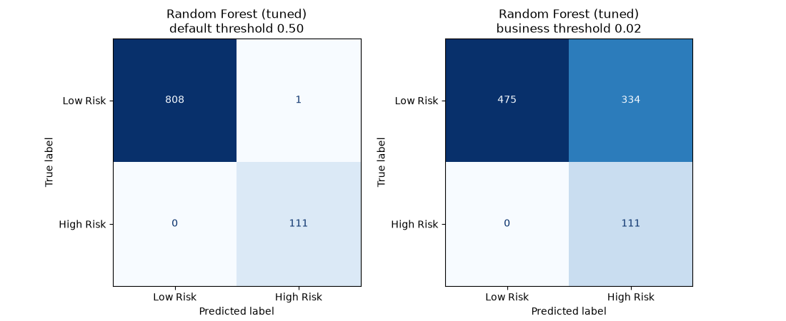

<div align="center">


<a href="https://github.com/RENSEE-GAJIPARA">
  
</a>

<br/>


</div>

---

## 📑 Table of Contents

- [Overview](#-overview)
- [Live App](#-live-streamlit-app)
- [Demo Video](#-demo-video)
- [Key Results](#-key-results)
- [Dataset](#-dataset)
- [Methodology](#-methodology)
- [Visual Results](#-visual-results)
- [Project Structure](#-project-structure)
- [Run Locally](#-run-locally)
- [Known Limitations](#-known-limitations)
- [Author](#-author)

---

## 🎯 Overview

**Risk Alert Classifier** is an end-to-end machine learning project that acts as an **early-warning system for a digital bank**. It flags customers who are likely to be **high risk** (default or fraud) so they can be reviewed manually before losses occur.

Only **~12% of customers are high risk**, so this is an **imbalanced classification** problem where plain accuracy is misleading (a model that always predicts "Low Risk" scores 87.9% accuracy with 0% recall). The project therefore focuses on:

- Building a baseline and comparing it against resampling strategies (Under-sampling, Over-sampling, SMOTE, ADASYN)
- Comparing Logistic Regression, Decision Tree and Random Forest
- Hyperparameter tuning with `RandomizedSearchCV` and `GridSearchCV`
- Choosing a **business-driven decision threshold** that minimises false negatives
- Deploying the final pipeline as an interactive **Streamlit** app

---


## 🚀 Live Streamlit App

<div align="center">

### 👉 [**Open the Live App**](https://YOUR-APP-NAME.streamlit.app) 👈

[](https://YOUR-APP-NAME.streamlit.app)

</div>

Enter a customer's profile (income, credit score, missed payments, utilisation, etc.) and the app returns:

| Output | Description |
|---|---|
| **Predicted Risk** | `HIGH RISK` or `LOW RISK` based on the tuned decision threshold |
| **Risk Probability** | Model probability for the High-Risk class |
| **Recommendation** | Manual-review alert for high-risk customers |
| **Model Accuracy** | Test-set accuracy loaded from `final_metrics.json` |

> 🔧 *Replace `https://YOUR-APP-NAME.streamlit.app` with your deployed Streamlit Community Cloud URL.*

---

## 🎬 Demo Video

<div align="center">

### ▶️ [**Watch the Demo on Google Drive**](https://drive.google.com/file/d/YOUR_FILE_ID/view?usp=sharing)

[](https://drive.google.com/file/d/YOUR_FILE_ID/view?usp=sharing)

</div>

The walkthrough covers the dataset, model comparison, threshold selection and a live prediction in the Streamlit app.

> 🔧 *Replace `YOUR_FILE_ID` with your Google Drive file ID. Set sharing to **"Anyone with the link can view"** so recruiters can open it.*

---


## 📈 Key Results

Final model: **Random Forest (RandomizedSearch → GridSearch tuned, `class_weight='balanced'`)** with a recall-first business threshold, evaluated on a held-out test set of **920 customers (111 high-risk)**.

| Model | Recall | F1 | AUC | False Negatives |
|---|:---:|:---:|:---:|:---:|
| Logistic Regression (baseline) | 1.000 | 1.000 | 1.000 | 0 |
| LR + SMOTE / Over / Under | 1.000 | 0.991 | 1.000 | 0 |
| LR + ADASYN | 1.000 | 0.982 | 1.000 | 0 |
| Decision Tree (default) | 0.838 | ~0.87 | 0.913 | 18 |
| Decision Tree (tuned) | ~0.95 | ~0.91 | 0.983 | 6 |
| Random Forest (default) | ~0.973 | ~0.99 | 1.000 | 3 |
| **Random Forest (tuned, final)** | **1.000** | – | **1.000** | **0** |

**Final deployed pipeline** (`Models/final_metrics.json`, threshold = 0.02):

| Accuracy | Precision | Recall | F1 | AUC | TN | FP | FN | TP |
|:---:|:---:|:---:|:---:|:---:|:---:|:---:|:---:|:---:|
| 0.637 | 0.249 | **1.000** | 0.399 | 1.000 | 475 | 334 | **0** | 111 |

The aggressive threshold trades precision for **zero missed high-risk customers**, reflecting the business rule that a missed risky customer (Type-II error) costs far more than an extra manual review (Type-I error).

---

## 🗂 Dataset

- **Size:** 4,600 customers, 17 model features + `risk_status` target
- **Target:** `risk_status` (0 = Low Risk, 1 = High Risk), **87.9% / 12.1%** split
- **Features:** demographics (`age`, `gender`, `region`, `employment_type`), financials (`annual_income_inr`, `debt_balance_inr`, `credit_score`, `credit_utilization_ratio`), behaviour (`missed_payments_12m`, `avg_late_payment_days`, `cash_advance_count_6m`, `monthly_transaction_count`, `monthly_spend_inr`), service/security (`complaints_last_6m`, `failed_login_attempts_3m`) and account (`account_tenure_months`, `days_since_last_txn`)
- **Missing values:** 7 features with roughly 2–5% gaps each (`credit_score` highest at 216)
- **Strongest signals:** average late-payment days (+0.71), missed payments (+0.67), cash advances (+0.55), credit utilisation (+0.50), credit score (−0.51)

---

## 🧪 Methodology

| Stage | What was done |
|---|---|
| **Part A – Theory** | Logistic Regression, metrics, Type-I/II errors, AUC-ROC, why imbalance hurts (see `Theory_Concepts.pdf`) |
| **Part B – Preparation** | Feature engineering (`days_since_last_txn`), stratified 80/20 split, standardisation, **KNN imputation (k=5)**, "Unknown" category for categorical gaps, one-hot encoding (29 columns) |
| **Part C – Baseline** | Logistic Regression baseline |
| **Part D – Imbalance** | Majority-class dummy model, Under-sampling, Over-sampling, SMOTE, ADASYN (training set only) |
| **Part E – Trees** | Decision Tree vs Random Forest, overfitting analysis |
| **Part F – Tuning** | `RandomizedSearchCV` (5-fold, F1 scoring) then `GridSearchCV`, with `class_weight` searched |
| **Part G – Evaluation** | ROC curves for all models, F2-based threshold selection from out-of-fold predictions |
| **Part H – Reporting** | Final pipeline exported to `risk_alert_pipeline.pkl` and served via Streamlit |

---

## 📊 Visual Results

<details open>
<summary><b>Data understanding</b></summary>

<p align="center"></p>
<p align="center"></p>

</details>

<details>
<summary><b>Baseline & imbalance handling</b></summary>

<p align="center"></p>
<p align="center"></p>

</details>

<details>
<summary><b>Tree models & tuning</b></summary>

<p align="center"></p>
<p align="center"></p>
<p align="center"></p>

</details>

<details>
<summary><b>ROC analysis & final threshold</b></summary>

<p align="center"></p>
<p align="center"></p>

</details>

---

## 📁 Project Structure

```
Risk-Alert-Classifier/
├── app.py                                       # Streamlit application
├── requirements.txt                             # Python dependencies
├── Images/                                      # Figures used in this README
│   ├── 01_class_distribution_missing.png
│   ├── 02_correlation_heatmap.png
│   ├── 03_baseline_confusion_matrix.png
│   ├── 04_imbalance_comparison.png
│   ├── 05_overfitting_train_vs_test.png
│   ├── 06_rf_default_confusion_matrix.png
│   ├── 07_tuned_vs_untuned.png
│   ├── 08_roc_all_models.png
│   └── 09_final_model_confusion_matrices.png
├── Reports/
│   ├── Final_Report.pdf                         # Final Report of whole project 
│   └── Theory_Concepts.pdf                      # Part A – conceptual answers
├── Notebooks/
│   └── Risk_Alert_Classifier.ipynb              # Full analysis & modelling
├── Datasets/
│   └── Risk_Alert_Classifier_Dataset.csv
├── Models/
│   ├── risk_alert_pipeline.pkl                  # Final preprocessing + model pipeline
│   └── final_metrics.json                       # Threshold & test metrics
└── README.md
```

---

## ⚙️ Run Locally

```bash
# 1. Clone
git clone https://github.com/RENSEE-GAJIPARA/Risk-Alert-Classifier.git
cd Risk-Alert-Classifier

# 2. (Optional) virtual environment
python -m venv venv
source venv/bin/activate        # Windows: venv\Scripts\activate

# 3. Install dependencies
pip install -r requirements.txt

# 4. Launch the app
streamlit run app.py
```

> ⚠️ The pickled pipeline should be loaded with the same `scikit-learn` version used to train it. Pin that version in `requirements.txt` if the app fails to load the model.

---

## ⚠️ Known Limitations

- **Near-perfect scores.** Several models reach AUC ≈ 1.00, which suggests the dataset is almost linearly separable (likely synthetic). Real-world performance would be lower and should be validated on production data.
- **Precision trade-off.** The deployed threshold (0.02) prioritises recall, producing many false alarms (334 on the test set).
- **Small minority class.** The test set contains only 111 high-risk customers, so metrics carry sampling uncertainty.

---

## 👤 Author

<div align="center">

**RENSEE GAJIPARA**

[](https://github.com/RENSEE-GAJIPARA)
[](https://www.linkedin.com/in/rensee-gajipara)
[](mailto:renseegajipara@gmail.com)

*If you found this project useful, consider giving it a ⭐*

</div>


